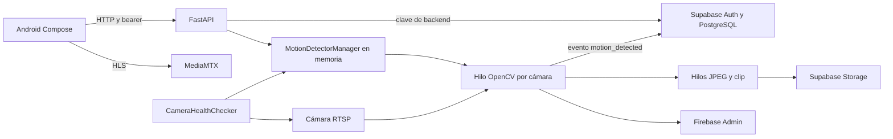

# Auditoría técnica — Camera Monitoring AI 2.0, FASE 0

Fecha: 2026-10-26 (America/Mexico_City). Estado: auditoría realizada; pendiente de revisión del usuario. **FASE 1 no iniciada.**

## 1. Alcance y procedencia

Plan leído íntegramente: [MASTER_PROMPT_AI_2_0.md](MASTER_PROMPT_AI_2_0.md). Se inspeccionaron backend, Android, gateway, contenedores, dependencias, migraciones, pruebas y scripts manuales. Esta entrega modifica exclusivamente este documento y [AI_FEATURE_BACKLOG.md](AI_FEATURE_BACKLOG.md). No corrige código, añade modelos, ejecuta migraciones remotas ni despliega.

- Checkout inicial limpio, rama local `work`, HEAD `d8045b58939bad2419cda984221d22c567b42419`: estaba desactualizado respecto al remoto.
- `git fetch origin main`: código vigente `fae1bad6211a58d770ab4396fc43a157846a411f`.
- El plan no estaba en `main`; se encontró mediante `git ls-remote --heads origin` en `docs/ai-vision-master-plan-2026-10-26`, commit `74fc4cbbe70e48383bf552bc8fd77e749598be04`.
- `git merge-base` confirmó que esa rama desciende del main vigente. `git diff --stat origin/main 74fc4cb` mostró únicamente la adición del plan. Se creó la rama de trabajo **`feat/ai-vision-platform`** desde ese commit, conservando el plan y la base vigente. No se modificó la referencia local `main`, no hubo merge ni push.
- No se encontraron `AGENTS.md` bajo `/workspace`. No hay configuración CI versionada en `.github`, GitLab, Jenkins ni Azure Pipelines, ni archivo LICENSE entre los nombres convencionales inspeccionados.
- Los resultados anteriores de onboarding sobre `d8045b5` no validan este nuevo código; las pruebas que siguen se ejecutaron de nuevo sobre `74fc4cb`.

## 2. Inventario: existe / parcial / falta / riesgo

«Existe» significa presencia de implementación, no certificación de producción.

| Componente | Estado | Evidencia real y límites |
| --- | --- | --- |
| API FastAPI | Existe | `backend/app/main.py`, routers auth/cameras/events/storage/admin. API se identifica como 1.0.0. |
| Auth | Existe / parcial | `auth.py`: registro, login, refresh, recuperación, perfil y tokens FCM. Supabase real no probado. |
| Roles y organizaciones | Parcial / riesgo P0 | `permissions.py`, `admin.py`, migración 009. `conductor` y `administrador_flota`, concesiones explícitas; divergencias API/RLS descritas abajo. |
| Cámaras y RTSP | Existe / riesgo P0 | `cameras.py`: CRUD, comprobación de conexión, stream URL. Valida esquema RTSP y rechaza credenciales en alta/edición; no limita destinos SSRF. |
| Streaming | Parcial / riesgo P0 | `gateway/mediamtx.yml` habilita RTSP/HLS, sin fuentes por cámara ni configuración de auth externa. HLS usa dirección de emulador. |
| Detección de movimiento | Existe | `motion_detector.py`: gris, blur, delta, umbral, dilatación, contornos, fondo adaptativo y cooldown. No es detector de objetos ni acciones. |
| Workers | Parcial | Un hilo daemon por cámara dentro del proceso API, restauración al arrancar y checker de conectividad. No servicio de visión desacoplado. |
| Zonas | Existe / parcial | `zone_store.py`, `main.py`, `test_zones.py`: polígonos normalizados, máscaras OpenCV y editor Compose. No reglas de entrada/salida, permanencia o líneas. |
| Horarios | Existe / parcial | `schedule_evaluator.py`, `camera_config.py`, migración 007: presets, días, horarios nocturnos y zona IANA. Riesgo de sobrescritura por checker. |
| Fotos de evidencia | Existe / defectos | `evidence_uploader.py`: JPEG calidad 80 y resize máximo 1280; subida asíncrona y actualización de ruta. Lectura API defectuosa. |
| Clips | Existe / parcial | `clip_recorder.py`: ring buffer 75 frames, 10 s posteriores, codecs de fallback, 3 grabaciones concurrentes por proceso. Lectura API defectuosa. |
| Retención/protección | Existe / parcial | `retention_manager.py`, `storage.py`, migración 008. 7/15/30/90 días, dry-run predeterminado, protección, limpieza por usuario. No scheduler automático conectado. |
| Alertas y revisión humana | Parcial | `notifications.py`, `events.py`: FCM, `pending/reviewed_ok/help_requested`. No taxonomía IA ni incertidumbre; actualización de revisión puede fallar silenciosamente. |
| Android | Existe / validación pendiente | Kotlin, Compose, Retrofit, OkHttp, Media3 HLS, Coil, Firebase Messaging. Pantallas auth, dashboard, cámara, stream, zonas, eventos, almacenamiento, cuenta y módulos admin. Sin build verificado aquí. |
| Objetos/tracking/conteos | Falta | No implementación ni dependencia de YOLO/ByteTrack/ONNX; búsqueda de símbolos/dependencias sin equivalente. |
| Poses/manos/acciones | Falta | Sin MediaPipe/MMAction2 ni modelos, datasets o pesos auditados. |
| Métricas/CI/contrato IA | Falta | Sin exportador de métricas, CI versionada, contrato versionado de inferencia, colas persistentes o pruebas de carga multicámara. |

## 3. Arquitectura actual y flujo de datos



La relación cámara → fuente MediaMTX no está provisionada por el código inspeccionado; el diagrama no presupone que HLS se publique automáticamente. OpenCV abre directamente la URL registrada, no consume un pipeline común de frames desde MediaMTX.

### Stack, entrypoints y configuración

- Backend: Python 3.12 (`backend/Dockerfile`), FastAPI, Uvicorn, Supabase Python, OpenCV headless, NumPy, multipart y Firebase Admin. Entrypoint: `uvicorn app.main:app` desde `backend` o `/code` en Docker.
- `docker-compose.yml`: API con `--reload`, bind mount `backend/app`, `.env`; MediaMTX `bluenviron/mediamtx:1`. Puertos 8000, 8554 y 8888 publicados sin limitar interfaz; configuración de desarrollo, sin límites CPU/RAM ni healthchecks Docker.
- `backend/requirements.txt` usa rangos abiertos; no lockfile Python ni dependencia pytest declarada. Docker usa tags mutables. Versiones instaladas para esta auditoría: Python 3.12.14, pytest 9.1.1, FastAPI 0.162.0, Uvicorn 0.54.0, Supabase 2.33.0, OpenCV 5.0.0.93, NumPy 2.5.4, Firebase Admin 7.7.0. `pip check`: sin conflictos.
- Android: AGP 9.4.1, Kotlin 2.2.10, Compose BOM 2026.02.01, compile/target SDK 35, min SDK 26; compatibilidad de fuente Java 17, daemon solicitado JDK 25, wrapper Gradle 9.6.0 con SHA256 en `gradle-wrapper.properties`. Host: JDK 21; sin `ANDROID_HOME` configurado. Compatibilidad efectiva no certificada porque el wrapper no pudo arrancar.
- Variables de backend: `SUPABASE_URL`, `SUPABASE_SECRET_KEY`; opcional `FIREBASE_CREDENTIALS_PATH`, defecto `/code/firebase_credentials.json`. No se usaron bindings reales en pruebas. No se copiaron secretos ni archivos `.env`.
- README está desactualizado: afirma que no hay registro de cámaras ni aplicación Android, aunque ambos están presentes.

### API real

Inventario generado desde `app.openapi()` a través de TestClient sobre el código auditado. Son **28 paths OpenAPI**, varios con múltiples métodos; no confundir paths con operaciones.

| Métodos | Path |
| --- | --- |
| GET | `/health`, `/health/db`, `/auth/me` |
| POST | `/auth/register`, `/auth/login`, `/auth/refresh`, `/auth/forgot-password`, `/auth/mediamtx` |
| POST, DELETE | `/auth/fcm-token` |
| GET, POST | `/cameras` |
| GET, PUT, DELETE | `/cameras/{camera_id}` |
| GET | `/cameras/{camera_id}/stream-url` |
| POST | `/cameras/{camera_id}/check-connection` |
| GET, POST | `/cameras/{camera_id}/detect-motion` |
| GET, POST, DELETE | `/cameras/{camera_id}/zones` |
| PUT, DELETE | `/cameras/{camera_id}/zones/{zone_id}` |
| GET, POST | `/events` |
| POST | `/events/{event_id}/review` |
| GET | `/events/{event_id}/evidence`, `/events/{event_id}/clip` |
| GET | `/storage/stats`, `/admin/overview`, `/admin/drivers` |
| PUT | `/storage/retention` |
| POST | `/storage/cleanup`, `/storage/events/{event_id}/protect`, `/admin/camera-grants` |
| GET, POST | `/admin/units` |

### Persistencia y migraciones

Tablas referidas: `auth.users`, `public.profiles`, `cameras`, `camera_events`, `camera_motion_configs`, `user_device_tokens`, `camera_detection_zones`, `user_retention_configs`, `organizations`, `transport_units`, `camera_access_grants`.

| Migración en `backend/migrations/` | Aporte / dependencia |
| --- | --- |
| 001_camera_motion_configs.sql | Configuración por cámara, trigger updated_at y RLS por propietario; presupone `cameras`. |
| 002_user_device_tokens.sql | Tokens FCM únicos y RLS por usuario; reutiliza función de 001. |
| 003_camera_connectivity_status.sql | Añade `last_seen_at`; no crea esquema base de cámaras. |
| 004_camera_detection_zones.sql | Polígonos JSONB, activos, RLS por propietario. Reutilizable; no duplicar. |
| 005_motion_evidence_storage.sql | Añade `evidence_path`; **no crea bucket ni políticas Storage**. |
| 006_motion_clips_storage.sql | Añade `clip_path`; **no crea bucket ni políticas Storage**. Reutilizar clips existentes. |
| 007_camera_schedule_configs.sql | Presets, horario, días y timezone en configuración existente; no crear otra tabla de horarios. |
| 008_retention_and_protection.sql | `camera_events.is_protected` y `user_retention_configs` con RLS. No añade scheduler ni rollback. |
| 009_roles_and_organizations.sql | Roles, organizaciones, unidades, concesiones, revisión de alertas, backfill, helpers SECURITY DEFINER, triggers y RLS/FORCE RLS. BEGIN/COMMIT no equivale a migración de reversión. |

No hay migraciones de bootstrap productivo para `cameras`, `camera_events` y `profiles`; el fixture `backend/app/tests/setup_test_db.sql` emula ese esquema y **borra schemas**. Solo se ejecutó en base desechable. No hay historial que demuestre qué SQL se aplicó realmente en Supabase ni definición versionada de sus buckets/políticas. No se inspeccionaron datos de producción.

Hay **dos versiones distintas de 009**: `backend/migrations/009_roles_and_organizations.sql` (420 líneas) y `backend/app/migrations/009_roles_and_organizations.sql` (395 líneas). `diff -u` confirma FORCE RLS y revocaciones condicionales solo en la primera; el test estructural prefiere la primera, mientras Dockerfile solo copia `app` y transporta la segunda. La ruta canónica debe acordarse antes de nuevas migraciones. No se aplicó la copia alternativa.

### Android y alertas

- `MainActivity.kt` y `ui/navigation/AppNavigation.kt` constituyen la entrada Compose. Los ViewModels usan repositorios que llaman `data/remote/ApiService.kt`; modelos DTO en `data/model/Models.kt`.
- `ui/stream/LiveStreamScreen.kt` usa Media3 y editor de polígonos/horarios; `EventHistoryScreen.kt` presenta fotos/clips y `StorageManagementScreen.kt` retención/protección. No hay overlays de objetos/tracking ni timeline de inferencia IA.
- `ApiClient.kt` fija `http://10.0.2.2:8000/`; HLS también fija `10.0.2.2:8888`. `TokenAuthenticator.kt` sincroniza refresh y limita reintentos. No añade auth al ExoPlayer que abre HLS mediante `MediaItem.fromUri`.
- `AdminPanelScreen.kt`, `AdminViewModel.kt`, `AdminRepository.kt` existen, pero no hay destino admin en `AppNavigation.kt`. `SessionManager` no persiste role/organization y reconstruye `SessionData` con role por defecto; no presumir administración utilizable en UI.
- El manifest efectivo `android/app/src/main/AndroidManifest.xml` no declara el servicio FCM ni POST_NOTIFICATIONS; aparecen en otro `AndroidManifest.xml` dentro del árbol Java, que no es el manifest principal por defecto. Falta verificar fusión/configuración Firebase en build. No se encontró `google-services.json` ni plugin google-services en app.

## 4. Hallazgos y riesgos priorizados

Los hallazgos estáticos no afirman una explotación remota ni describen el estado de un despliegue real. Las reproducciones locales usan datos sintéticos y mocks estrictos.

| ID / prioridad | Hallazgo comprobado | Evidencia / consecuencia |
| --- | --- | --- |
| SEC-01 P0 | Concesiones sin control de organización en API | `admin.py:grant_camera_access` verifica rol y hace upsert de camera_id/user_id arbitrarios con cliente privilegiado, sin comprobar organizaciones de cámara y destinatario. La política SQL no sustituye autorización del backend cuando se usa service_role/BYPASSRLS. |
| SEC-02 P0 | Lectura y mutación comparten autorización | `cameras.py:update_camera/delete_camera` y `events.py:create_event` aceptan `has_camera_access`, que también concede lectura explícita. No distingue permiso de lectura de administración. RLS de cámaras no concede UPDATE/DELETE al mero grant, pero el backend usa clave privilegiada. Definir matriz efectiva. |
| SEC-03 P0 | Gateway no conecta auth externa | `gateway/mediamtx.yml` no configura callback. `auth.py:authenticate_mediamtx_stream` autoriza cualquier payload con action=publish o ip local declarada en JSON; TestClient anónimo con publish devolvió 200. No usar este callback como control de confianza sin autenticar el gateway. Compara path por substring de rtsp_url y también consulta todas las cámaras. |
| SEC-04 P0 | SSRF y exposición de URLs | Alta/edición rechazan userinfo, pero permiten cualquier hostname/red/puerto RTSP y workers/checker lo abren. No hay control DNS/IP ni egress por cámara. `_format_camera` devuelve RTSP al cliente y `motion_detector.py:run` / `connectivity_checker.py` registran URL completa en fallos. Datos legados podrían incluir credenciales aunque las altas actuales las rechacen. |
| SEC-05 P0 | Helpers RLS sin EXECUTE para authenticated | 009 revoca de PUBLIC/anon, sin GRANT a authenticated. En base sintética con cadena 001–009 y grants SELECT mínimos, consulta de cameras como authenticated falla con `permission denied for function get_auth_user_organization_id` (psql exit 3). La suite SQL lo oculta al conceder ALL ON ALL FUNCTIONS. FORCE RLS no restringe roles BYPASSRLS. |
| SEC-06 P1 | Sesión Android y transporte | Manifest permite cleartext y backup; API/HLS usan HTTP. `SessionManager.createEncryptedPrefs` recurre a SharedPreferences sin cifrado si falla recreación. `MyFirebaseMessagingService.kt` registra prefijo de token. Necesita análisis de backup, release/TLS y logs; no se reprodujeron filtraciones reales. |
| BUG-01 P0 | Evidencias/clips/revisión ausentes al leer | `events.py:list_events` selecciona solo id,camera_id,event_type,detected_at,description y después usa evidence_path,clip_path,is_protected,review_status,reviewed_at. Endpoints evidence/clip seleccionan solo id,camera_id. Fake que respeta proyección reproduce has_evidence=False y has_clip=False aun con rutas en la fila. Los mocks actuales devuelven columnas no seleccionadas. |
| BUG-02 P0 | `stream-url` proyecta registro incompleto | `cameras.py:get_camera_stream_url` selecciona id,rtsp_url y llama `_format_camera`, que necesita record['name']. Invocación con esa forma produjo KeyError 'name'. No se conectó a Supabase. |
| BUG-03 P0 | Administrador de flota denegado indebidamente | `permissions.py:has_camera_access` selecciona id,user_id y consulta organization_id inexistente en el resultado. Reproducción con proyección estricta: admin de la misma org sin grant recibe False; `get_authorized_camera_ids` sí puede listar esas cámaras. |
| BUG-04 P1 | Revisión devuelve éxito aunque no persista | `events.py:review_event_alert` silencia excepción de update y devuelve estado/fecha solicitados. No existe reviewed_by para auditoría. |
| PIPE-01 P0 | Lifecycle y aislamiento de workers incompletos | Worker dentro de API; `stop_detector/stop_all` no hacen join. `read()` fallido no libera/reabre mientras isOpened continúe True. Sin timeouts explícitos de VideoCapture ni colas de trabajo durables; DB/FCM se llaman sincrónicamente desde hilo de captura. Múltiples procesos API duplicarían restauración/checker y semáforos. |
| PIPE-02 P1 | Checker puede sobrescribir configuración | `check_and_update_camera` llama start_detector con solo min_area/threshold/cooldown, dejando horario/preset con defaults; `set_config` persiste esos defaults. Su timeout_sec=3 no se utiliza. `is_active` es hilo vivo + horario, no salud de frames/inferencia. |
| PIPE-03 P1 | Memoria/FPS de clips no corresponden a tiempo garantizado | Buffer 75 imágenes a resolución original, frame_interval=0.1 y clip fps=10; “~5 s” en comentario no está garantizado (75/10=7.5 s nominales). Post-evento copia latest_frame a reloj propio, puede duplicar frames. Semáforo limita ejecución a 3, pero dispatch crea hilos sin cola acotada; fotos también crean hilos por evento. |
| DATA-01 P1 | Persistencia degradada y carreras | `camera_config.py` escribe JSON sin lock/atomicidad; ante error deshabilita Supabase para esa instancia. `zone_store.py` usa fallback en memoria y silencia fallos de escritura/eliminación. No ofrece garantías equivalentes a DB. |
| DATA-02 P1 | Retención no automática y contadores no transaccionales | No hay caller programado de cleanup con is_auto_trigger=True. Rechequeo de is_protected deja ventana de carrera entre consulta y borrado. Contadores aumentan antes de confirmar eliminación y freed_mb es estimación 0.2/2.5 MB. Estadísticas Storage sin paginación pueden ser incompletas. |
| QA-01 P0 | Falsos niveles de confianza de suites | 41 tests pasan con fixtures, pero mocks no respetan proyecciones ni simulan autorización RLS. SQL tiene ON_ERROR_STOP off y puede terminar exit 0 con errores; caso 6 no llega a validar unidad cruzada. No hay regresión para SEC-01/02/03 ni auth streaming completa. |
| OPS-01 P1 | Reproducibilidad y documentación | README desfasado, sin CI/lockfile/SBOM ni auditoría de dependencias/licencias. Tags mutables y configuración dev. No hay SLO de visión ni presupuesto de recursos medido sobre cámaras. |

### Autorización por capa

`get_current_user` valida bearer vía Supabase Auth y carga profile; ante error de profile degrada a conductor sin organización. Algunas rutas usan owner-only (`main.py` zonas/movimiento, retención) y otras owner/grant/flota (`cameras.py`, `events.py`). Workers restauran **todas** las cámaras con clave de backend y no llevan organization_id en su contrato interno. Evidencias usan prefijo `user_id/camera_id/event_id`; no existe segmentación explícita por organización. Se necesita coherencia API + workers + Storage + SQL antes de añadir IA. Una suite mocked aprobada no prueba esa coherencia.

## 5. Pruebas reales, aislamiento y resultados

### Python

Se ejecutaron los tests versionados **sin modificar sus archivos** mediante un envoltorio temporal reproducido en el apéndice A. Se eliminan bindings reales; las conexiones Python AF_INET/AF_INET6 se bloquean, el cliente Supabase global lanza una excepción y VideoCapture se sustituye por captura cerrada salvo mocks propios de cada test. Configuración JSON dirigida a TemporaryDirectory. OpenCV de procesamiento/codec y TestClient siguen siendo reales. Esta envoltura valida lógica/fixtures, no RTSP real ni integraciones externas. No se alteró configuración JSON existente del checkout.

| Comando desde cualquier directorio | Resultado |
| --- | --- |
| `.venv/bin/python /tmp/camera-ai-phase0/run_unit_audit.py` | **35 passed, 6 failed**, exit 1, 0.86 s; sin variables Supabase. |
| `.venv/bin/python /tmp/camera-ai-phase0/run_unit_audit.py --fixtures` | **41 passed**, exit 0, 0.77 s; URL `.invalid` y texto ficticio solo para satisfacer comprobaciones de presencia; todos los clientes reales bloqueados. |
| `.venv/bin/python -m pip check` | Sin requisitos incompatibles. |

Los seis fallos iniciales fueron: clip upload (1), JPEG upload (1), evidence endpoints (2), tenant events (1), signup (1). Son precondiciones de fixtures ausentes: faltan variables que el código consulta incluso con create_client mockeado. **No se corrigieron con credenciales reales.** No quedaron pruebas omitidas/xfail en la ejecución de 41 casos. Cinco avisos de deprecación: TestClient/httpx y on_event/lifespan; no son fallos.

Distribución de los 41: motion 10 (dos suites parecidas), CRUD lifecycle 2, clips 2, conectividad mock 2, evidencia upload 1, endpoints evidencia 2, retención 6, horarios 4, estructura SQL 6, tenant 3, zonas 3. El test de cooldown reproduce una condición temporal en el propio test; no verifica todo el loop real. TestClient de los tests existentes no usa contexto lifespan y los mocks tenant pueden pasar por denegación ante DB no disponible, sin comprobar acceso positivo. No hay métricas de cobertura recogidas.

Smoke adicional del código actual con `TestClient(app)` en contexto lifespan y Supabase **unset**: `/health` 200, `/health/db` 503 esperado por falta de configuración, `/cameras` sin bearer 401, `/openapi.json` 200. No se reutilizó el proceso API antiguo del onboarding para validar código nuevo.

Sondas adicionales locales, sin Supabase: formato de registro stream produjo KeyError 'name'; proyección estricta evidence/clip devolvió ausencia falsa; admin de misma org devolvió False; callback MediaMTX publish sin bearer devolvió 200. Son reproducciones de los hallazgos, no nuevos tests productivos ni arreglos.

### PostgreSQL aislado

Contenedor propio `camera-ai-phase0-postgres`, imagen verificada por digest `postgres@sha256:baa22e6286bf832cb147b8bb5aa9d8bc999846d69c21d11bf63f58fbeed1fa48` (PostgreSQL 15.19, x86_64), **`--network none`**, sin puertos publicados, checkout montado readonly. Autenticación trust confinada a este contenedor desechable; ninguna credencial real. Roles sintéticos test_admin (superuser), authenticated, anon y service_role BYPASSRLS. No es equivalente completo a Supabase administrado.

1. En `camera_monitoring_test`: fixture existente `setup_test_db.sql` + migración canónica 009 con `ON_ERROR_STOP=1`: exit 0.
2. Suite existente `run_real_postgres_security_tests.sql`: exit 0 **no implica suite aprobada**, porque desactiva ON_ERROR_STOP. Se inspeccionó salida:
   - Caso 1: 3 perfiles, 12 cámaras, 12 eventos conservados.
   - Casos 2 y 3: A y B ven 6 cámaras cada uno; esperado.
   - Casos 4 y 5: errores esperados al escalar rol y cambiar propietario; rollback.
   - Caso 6: **inválido como prueba de unidad cruzada**. Al preparar organización con rol test_admin, trigger rechaza primero el cambio de organization_id; la siguiente instrucción solo recibe transaction aborted. No demuestra la validación pretendida.
   - Caso 7: B ve 7 cámaras tras concesión dentro de transacción; rollback.
   - El runner no incorpora assertions de conteos/errores; resultados anteriores son lectura explícita de salida, no “7 tests passed”.
3. En otra base nueva `camera_monitoring_chain`: mismo fixture + **todas las migraciones canónicas 001–009**, secuencialmente con `ON_ERROR_STOP=1`: todas aplicadas, exit 0. Esto verifica compatibilidad con fixture previo, no instalación desde base vacía ni políticas Storage.
4. Consulta como authenticated en esa cadena, con USAGE public y SELECT cameras pero sin GRANT adicional a helpers: **falló**, exit 3, `permission denied for function get_auth_user_organization_id`. Confirma SEC-05. El GRANT ALL ON ALL FUNCTIONS de la suite de seguridad oculta esta carencia.

Comandos reproducibles y precauciones en apéndice B. No se aplicaron migraciones a producción, no se alteró SQL del repositorio y no se ejecutó `migrate_configs.py`.

### Android y scripts excluidos

- Intentado desde `android`: `GRADLE_USER_HOME=/tmp/camera-ai-phase0/gradle bash ./gradlew :app:testDebugUnitTest --no-daemon --offline --max-workers=2` → exit 1, `UnknownHostException: services.gradle.org`. El wrapper necesita primero su distribución aun con --offline. **Tests JVM NO EJECUTADOS**, no confundir fallo de bootstrap con test de aplicación fallido. No se cambió checksum ni versión para forzar éxito.
- Tests instrumentados, APK y emulador: **NO EJECUTADOS**; sin toolchain/SDK resuelto y sin dispositivo. Los 5 casos de `TokenAuthenticatorTest.kt`, el ejemplo JVM y el ejemplo instrumentado solo se inspeccionaron.
- `test_system.py`: **NO EJECUTADO**. Contiene cuentas/contraseñas de prueba embebidas, altas y modificaciones de usuarios via admin y CRUD con borrado contra el backend configurado; no tiene un destino aislado explícito. No reproducir credenciales de ese archivo en documentos/logs nuevos.
- `probar_login.py`, `probar_listado.py`, `probar_camara.py`: **NO EJECUTADOS**; requieren login manual y el último crea cámaras reales. Flujo Auth/Supabase, buckets, URLs firmadas, FCM y HLS con video real: **NO EJECUTADO** por ausencia de fixtures de integración aislados/autorizados.

## 6. Línea base medible y límites

Host Linux x86_64, nproc=5 visibles; cuota cgroup `400000/100000` (4 CPU equivalentes), memoria cgroup 32 GiB, sin swap observado. Mediciones del host no son reserva de capacidad. Sin GPU evaluada.

Microbenchmark real del método `MotionDetectorWorker.process_frame`, frames sintéticos sin datos personales (gris + rectángulo), sin zonas, horario 24/7, 1 hilo OpenCV, 20 warmups y 200 frames medidos por resolución. FPS=frames/tiempo de pared, p95 por muestra ordenada índice 189. Se ejecutó en proceso que también había cargado API/TestClient, por lo que RSS es pico acumulado del proceso, **no RAM de worker aislado**.

| Resolución | FPS de procesamiento sin throttling | p50 ms | p95 ms | CPU s / pared s | CPU de un núcleo | RSS pico proceso MiB |
| --- | ---: | ---: | ---: | --- | ---: | ---: |
| 640×480 | 427.44 | 2.20 | 3.15 | 0.468 / 0.468 | 99.97% | 114.01 |
| 1280×720 | 151.91 | 6.05 | 9.90 | 1.316 / 1.317 | 99.93% | 121.66 |

**No son FPS de cámara ni de IA**: excluyen captura, decodificación RTSP, sleep de 0.1 s, DB, FCM, grabación, red y contención multicámara. El loop actual tiene techo nominal inferior a 10 FPS por su sleep más procesamiento; no se midió con stream. No se fijan SLO usando estos valores.

| Métrica solicitada | Estado real |
| --- | --- |
| FPS y latencia de algoritmo actual | Microbenchmark sintético arriba; no end-to-end. |
| CPU/RAM | Medidas del proceso sintético; no extrapolar a 2/4 cámaras. |
| Reconexiones, tiempo a primer frame, recuperación | NO MEDIDOS; sin fuente RTSP controlada y prueba de fallos. |
| Tasa de alertas / falsos positivos | NO MEDIDA; no se dispone de video etiquetado/escenario representativo. 5 s cooldown por defecto es configuración, no tasa observada. |
| Almacenamiento real, MB/h, subida/retención | NO MEDIDOS con backend aislado de Storage. `freed_mb` en código es estimación, no telemetría. |
| Buffer crudo | Cálculo, no medición: 75×1920×1080×3 ≈445 MiB/cámara, sin copias postevento/overhead; evidencia de necesidad de presupuesto. |

## 7. Propuesta adaptada (diseño, no implementación)

1. Cerrar/revisar los P0 en backlog antes de habilitar visión: autorización por acción/tenant, gateway, proyecciones API, helpers RLS y estrategia de migraciones/tests. Mantener contratos existentes de auth/cámaras, sin eliminar funciones.
2. Separar progresivamente plano de control FastAPI del procesamiento de frames: hoy sí existe motor de movimiento equivalente parcial, pero **no un vision-worker aislado**. Extraer un adaptador de captura reutilizable y probarlo antes de retirar cualquier camino actual. Una cámara tendrá un propietario de captura; no abrir decodificadores duplicados para cada regla/modelo.
3. Diseñar worker con reconexión/backoff, timeout de apertura/lectura, cancelación/join, cola acotada y política drop-old para inferencia. FPS de inferencia separado de captura/evidencia; no copiar frames ilimitadamente. No elegir broker ni GPU sin métricas/capacidad y decisión revisada.
4. Contrato propuesto versionado: schema_version, event_id, camera_id, organization_id validada por backend, timestamp UTC, model_version/procedencia, class, confidence, bbox normalizada, track_id temporal, rule_id y evidencia opcional. organization_id no se aceptará como autoridad del cliente ni se inventará para cámaras legadas sin organización. Correlación/idempotencia, expiración y revisión humana quedan en contrato.
5. Reutilizar zonas de 004, clip_path de 006, horarios de 007, protección/retención de 008 y relaciones de 009. Revisar si hace falta extensión aditiva de eventos/reglas, sin crear tablas/buckets duplicados. **No se diseñó ni ejecutó migración nueva en FASE 0.** Documentar rollback, backfill y compatibilidad antes de cualquier SQL futuro.
6. Conservar `motion_detected` y comportamiento anterior mediante flags por cámara; comparación shadow en entorno de prueba, sin push sensible, permitirá evaluar un futuro detector. Modelos/pesos externos solo tras auditoría comercial/licencias/procedencia/vulnerabilidades.
7. Android ampliará controles/overlays sobre pantallas existentes tras reparar y validar contratos. Ningún track temporal será identidad persistente; acciones ambiguas generarán “posible” con revisión humana, sin reconocimiento facial ni seguimiento entre cámaras.
8. Añadir telemetría de frames recibidos/descartados, edad de frame, reconexiones, p50/p95 por etapa, colas, FPS efectivo, CPU/RSS, errores de persistencia, MB de evidencia y tasa de alertas. Datos etiquetados/licenciados y benchmarks 1→2→4 cámaras solo con límites de recursos y parada definidos.

## 8. Cierre y decisión pendiente

Entregables de FASE 0 producidos, pruebas disponibles seguras ejecutadas y carencias registradas. **Esto no declara el producto listo para producción ni aprueba FASE 1**. Bloqueos: revisión del usuario, P0 de seguridad/consistencia, prueba SQL de unidad cruzada válida, reproducción Android con toolchain disponible y entorno de integración aislado para streaming/Storage/Auth. No se requiere una clave de producción para aceptar esta auditoría.

Siguiente paso: revisión de ambos documentos y autorización explícita del usuario para el alcance de FASE 1 y sus prerrequisitos. Hasta entonces no implementar, migrar, desplegar ni hacer merge. El SHA de la entrega documental se obtiene de `git log -1 --oneline` y se informa en la respuesta final; se evita un SHA autorreferencial inventado dentro del commit.

## Apéndice A — Envoltura exacta de las pruebas Python

Archivo temporal usado: `/tmp/camera-ai-phase0/run_unit_audit.py`. Para reproducirlo, guardar este bloque fuera del checkout, crear `/tmp/camera-ai-phase0` para los XML y ejecutar con el Python del venv. Cambiar únicamente la ruta de checkout si procede. Texto ficticio no es una credencial utilizable.

```python
import os, sys, socket, tempfile
from unittest.mock import patch
os.chdir('/workspace/camera-monitoring/backend')
sys.path.insert(0, os.getcwd())
for key in ('SUPABASE_URL','SUPABASE_SECRET_KEY','FIREBASE_CREDENTIALS_PATH','GOOGLE_APPLICATION_CREDENTIALS'):
    os.environ.pop(key, None)
if '--fixtures' in sys.argv:
    os.environ['SUPABASE_URL']='https://supabase.invalid'
    os.environ['SUPABASE_SECRET_KEY']='offline-test-placeholder'
original_connect=socket.socket.connect
original_connect_ex=socket.socket.connect_ex

def offline_connect(s, address):
    if s.family in (socket.AF_INET, socket.AF_INET6):
        raise RuntimeError('PHASE0: external network disabled in Python test process')
    return original_connect(s,address)

def offline_connect_ex(s, address):
    if s.family in (socket.AF_INET, socket.AF_INET6):
        raise RuntimeError('PHASE0: external network disabled in Python test process')
    return original_connect_ex(s,address)

class ClosedCapture:
    def __init__(self,*args,**kwargs): pass
    def isOpened(self): return False
    def read(self): return False,None
    def release(self): pass

with tempfile.TemporaryDirectory(prefix='camera-phase0-') as tmp, \
     patch('socket.socket.connect', offline_connect), \
     patch('socket.socket.connect_ex', offline_connect_ex), \
     patch('supabase.create_client', side_effect=RuntimeError('PHASE0: real Supabase client disabled')), \
     patch('cv2.VideoCapture', ClosedCapture):
    import app.camera_config
    app.camera_config.config_store.file_path=os.path.join(tmp,'camera_configs.json')
    import pytest
    result=pytest.main(['tests','app/tests','-q','--junitxml=/tmp/camera-ai-phase0/'+('fixtures' if '--fixtures' in sys.argv else 'noenv')+'.xml'])
    from app.motion_detector import motion_manager
    motion_manager.stop_all()
    sys.exit(result)
```

XML de esta ejecución: `/tmp/camera-ai-phase0/noenv.xml` y `fixtures.xml`; son artefactos locales, no se garantiza su conservación tras restaurar el entorno. Los resultados y el procedimiento quedan versionados aquí. La envoltura no es un sandbox general de cualquier código: bloquea los accesos identificados en las suites inspeccionadas y no ejecuta los scripts manuales.

## Apéndice B — Reproducción SQL solo desechable

**No ejecutar setup_test_db.sql contra una base existente: contiene DROP SCHEMA CASCADE.** Estos comandos crean su propio contenedor sin red y utilizan explícitamente sockets internos del mismo; el nombre debe estar libre. Nunca sustituirlos por URL/DSN de Supabase. Los grants son preparación exclusiva del fixture, no recomendación de producción.

```bash
docker run -d --name camera-ai-phase0-postgres --network none \
  -e POSTGRES_HOST_AUTH_METHOD=trust \
  --mount type=bind,src=/workspace/camera-monitoring,dst=/repo,readonly \
  postgres@sha256:baa22e6286bf832cb147b8bb5aa9d8bc999846d69c21d11bf63f58fbeed1fa48
docker exec camera-ai-phase0-postgres pg_isready -U postgres
# Continuar solo cuando pg_isready confirme disponibilidad.
docker exec camera-ai-phase0-postgres psql -U postgres -v ON_ERROR_STOP=1 \
  -c 'CREATE ROLE test_admin SUPERUSER LOGIN;' \
  -c 'CREATE ROLE authenticated NOSUPERUSER;' \
  -c 'CREATE ROLE anon NOSUPERUSER;' \
  -c 'CREATE ROLE service_role NOSUPERUSER BYPASSRLS;' \
  -c 'CREATE DATABASE camera_monitoring_test OWNER test_admin;'
docker exec camera-ai-phase0-postgres psql -U test_admin -d camera_monitoring_test \
  -v ON_ERROR_STOP=1 -f /repo/backend/app/tests/setup_test_db.sql
docker exec camera-ai-phase0-postgres psql -U test_admin -d camera_monitoring_test \
  -v ON_ERROR_STOP=1 -f /repo/backend/migrations/009_roles_and_organizations.sql
docker exec camera-ai-phase0-postgres psql -U test_admin -d camera_monitoring_test \
  -f /repo/backend/app/tests/run_real_postgres_security_tests.sql
# Inspeccionar salida; exit 0 de este último comando NO determina éxito.
```

Para la cadena se creó otra DB `camera_monitoring_chain`, se ejecutó el mismo fixture, y dentro del contenedor:

```bash
set -e
for migration in /repo/backend/migrations/*.sql; do
  psql -U test_admin -d camera_monitoring_chain -v ON_ERROR_STOP=1 -f "$migration"
done
```

Consulta diagnóstica ejecutada en la cadena, sin grants de funciones añadidos por la suite:

```sql
GRANT USAGE ON SCHEMA public TO authenticated;
GRANT SELECT ON public.cameras TO authenticated;
BEGIN;
SET LOCAL ROLE authenticated;
SET LOCAL request.jwt.claim.sub = 'f7210242-a53d-495b-a7d7-26f0e0313ca1';
SELECT count(*) FROM public.cameras;
ROLLBACK;
```

Resultado real: permission denied del helper, exit 3 con ON_ERROR_STOP=1; al cerrar la sesión se aborta la transacción. El contenedor propio se detuvo al terminar la auditoría. No se detuvieron procesos de otros trabajos.

## Apéndice C — Método reproducible del microbenchmark

Desde `backend`, con el Python de `.venv` y sin variables Supabase, se cargó API/TestClient para el smoke indicado arriba, después se ejecutó el siguiente núcleo de medición. No abre fuentes, no arranca `worker.run()` ni inserta eventos. La memoria depende de módulos previamente cargados, por lo que valores de otra ejecución no deben coincidir exactamente.

```python
import time, resource, json, statistics
import cv2
import numpy as np
from app.motion_detector import MotionDetectorWorker
cv2.setNumThreads(1)
for width, height in [(640, 480), (1280, 720)]:
    worker = MotionDetectorWorker('synthetic', 'unused')
    bg = np.full((height, width, 3), 128, dtype=np.uint8)
    moved = bg.copy()
    cv2.rectangle(moved, (100, 100), (220, 220), (255, 255, 255), -1)
    _, _, ref = worker.process_frame(bg, None)
    for _ in range(20):
        worker.process_frame(moved, ref)
    times = []
    cpu_start = time.process_time()
    start = time.perf_counter()
    for i in range(200):
        t = time.perf_counter()
        worker.process_frame(bg if i % 2 else moved, ref)
        times.append((time.perf_counter() - t) * 1000)
    wall = time.perf_counter() - start
    cpu = time.process_time() - cpu_start
    print(json.dumps(dict(
        width=width, height=height, frames=200, threads=cv2.getNumThreads(),
        fps=200/wall, latency_p50_ms=statistics.median(times),
        latency_p95_ms=sorted(times)[189], cpu_seconds=cpu,
        wall_seconds=wall, cpu_one_core_pct=100*cpu/wall,
        process_peak_rss_mib=resource.getrusage(resource.RUSAGE_SELF).ru_maxrss/1024
    )))
```


## Seguimiento posterior a esta auditoría

Este documento conserva la evidencia histórica de FASE 0. El usuario autorizó FASE 1 después de su entrega. Las correcciones y validaciones posteriores se registran en [PHASE_1_VISION_INFRASTRUCTURE.md](PHASE_1_VISION_INFRASTRUCTURE.md) y en el avance del [backlog](AI_FEATURE_BACKLOG.md); no interpretar los hallazgos originales como estado inmutable ni los pendientes SQL/gateway como resueltos.
