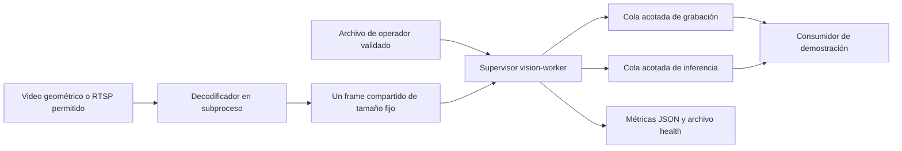

# FASE 1 — Infraestructura de visión aislada

Fecha: 2026-10-26. Rama: `feat/ai-vision-platform`.

**Entrega de infraestructura de desarrollo, sin activación con datos reales.** El usuario autorizó continuar con FASE 1 tras la auditoría. No se inició FASE 2, no se incorporaron detectores/modelos/pesos, no se ejecutó SQL nuevo y no se modificó `main` ni producción.

Commits de implementación: `f58e4ad` (correcciones API/aislamiento de pruebas) y `bd76506` (worker, contratos y validación). Este informe no convierte los P0 históricos pendientes en resueltos. La salida global propuesta en el backlog, que incluía cerrar esos P0, **sigue pendiente**; el pipeline aislado sí está implementado y probado.

## 1. Inventario previo y alcance acordado

| Estado previo | Evidencia | Decisión de esta iteración |
| --- | --- | --- |
| Existe movimiento OpenCV dentro de API | `motion_detector.py`, restauración y checker | Conservar ese camino. No reemplazarlo ni iniciar capturas paralelas automáticamente. |
| Parcial: reconexión, sin cierre duro/colas/contrato IA | Auditoría PIPE-01/02 | Worker separado, explícito y sin acceso a backend productivo. |
| Falta servicio desacoplado y métricas | VIS-01–05 | Implementación en `backend/app/vision/`; Compose independiente. |
| Riesgo P0 en selección de columnas y autorización API | BUG-01/02/03, SEC-01/02 | Correcciones acotadas con regresiones de acceso positivo y negativo. |
| Riesgo RLS/gateway/SSRF legado | SEC-03/04/05 y QA SQL | No activar integración real ni migrar sin revisión. Política restrictiva para la nueva fuente RTSP; los riesgos legados permanecen registrados. |

Se reutiliza stack Python/OpenCV/Pydantic existente. `pydantic>=2.9,<3` se declara explícitamente por ser dependencia directa del nuevo contrato; `requirements-dev.txt` declara pytest. No se duplican esquemas, tablas de zonas, clips, horarios, retención ni organizaciones de las migraciones 004/006/007/008/009.

## 2. Arquitectura implementada



La demostración **consume frames, no ejecuta inferencia ni graba/sube clips**. Los nombres de las colas representan las futuras salidas de procesamiento y evidencia; el grabador existente sigue funcionando en el camino legado. No hay llamadas Supabase/FCM desde este servicio, ni HTTP público, ni escritura de eventos. Esta frontera evita ampliar privilegios o depender de RLS pendiente de revisión.

### Captura, backpressure y cancelación

- `CameraWorker` supervisa un decodificador `spawn` por cámara. `start()` es idempotente para esa instancia; `stop()` espera cierre y escala a terminate/kill si el hijo no responde. Una configuración no admite IDs de cámara duplicados.
- Timeouts de apertura y lectura llegan tanto a OpenCV/FFmpeg como al watchdog del supervisor. Resolución DNS y apertura del decoder quedan dentro del ciclo supervisado. `read()` fallido cierra la captura y provoca reapertura aunque `isOpened()` no haya cambiado.
- Reintentos con backoff configurable y espera cancelable. EOF de archivos también genera reconexión, lo que permite fixtures repetibles; no significa soporte de playlist/red arbitraria.
- La primera versión experimental con `multiprocessing.Queue` de imágenes se descartó: un test de kill durante transporte mostró bloqueo por mensaje parcial. La implementación entregada usa **un slot compartido fijo** y lock con adquisición limitada por timeout. Si un proceso muere con lock adquirido, se abandona el slot entero y se crea otro, sin esperas de pipe/feeder.
- Dos colas locales independientes, capacidad configurable 1–8; al llenarse se descarta el frame antiguo. Se cuentan drops y muestras. El transporte desde decoder conserva solo el frame más reciente, contando saltos de secuencia observados. Los drops en EOF/kill pueden no contarse exactamente si no llega otra secuencia.
- FPS separados: capture, recording e inference. Los dos últimos no pueden exceder captura. No son promesas de rendimiento: cadencia, arranque, stream y carga afectan FPS observado.
- Frames entregados con scope completo, sesión temporal, secuencia, UTC y reloj monotónico; arrays marcados readonly. Frames caducados no se entregan, incluso después de perder la fuente. La marca de captura es al terminar lectura/resize, **no la hora de exposición original de la cámara**.
- Resize conservando aspecto hasta dimensiones configuradas, máximo 1280×720. Presupuesto validado de buffers estimados ≤64 MiB entre cámaras (slot, colas y copias en vuelo); el límite Docker de memoria también cubre librerías/decoder. No garantiza ausencia de OOM con streams arbitrarios.

No hay lease distribuido: la unicidad se garantiza dentro del supervisor/configuración, no entre varias máquinas ni frente al motor legado. No alimentar la misma cámara real a ambos caminos hasta diseñar esa coordinación. El servicio no restaura automáticamente cámaras desde la base.

### Configuración y observabilidad

Archivo de ejemplo: `backend/vision-worker.example.json`, con una cámara ficticia y fuente geométrica. Máximo 4 entradas por configuración, sujeto al presupuesto de buffers; solo se midió una cámara en esta entrega.

Métricas por cámara: estado/healthy, edad del último frame, intentos, reconexiones, errores tipados, frames recibidos, muestras/consumos/drops/caducados por cola, FPS observado, profundidades/capacidades, p50/p95 de lectura/generación+resize y edad al consumir. Las ventanas retienen hasta 256 muestras; porcentiles con pocas muestras son solo diagnóstico.

En Linux se observan CPU acumulada y RSS de supervisor/decodificador mediante `/proc`. La CPU del decoder corresponde al proceso actual o a su última muestra antes de finalizar, **no suma histórica de todos los reinicios**. RSS es memoria residente, no reserva ni capacidad de cámaras. En plataformas sin esos contadores se devuelve null, sin inventar métricas.

El CLI genera JSON de health por reemplazo atómico en `/tmp/vision-health.json`. El healthcheck verifica estado healthy y frescura del archivo; al detenerse se escribe healthy=false. No expone URLs ni datos visuales en métricas.

## 3. Contrato de evento v1

Código: `backend/app/vision/contracts.py`. Esquema publicable: [DETECTION_EVENT_V1.schema.json](DETECTION_EVENT_V1.schema.json).

Incluye `schema_version="1.0"`, event_id, camera_id, owner_id, organization_id nullable para cámaras personales, timestamp normalizado UTC, model_version, `class`, confidence finita [0,1], bbox normalizada de área positiva, worker_session_id, track_id temporal opcional, rule_id opcional, evidencia opcional y review_status=pending.

- Identificadores UUID; campos extra rechazados; timestamps ingenuos, NaN/Infinity y cajas inválidas rechazados.
- Serializar para transporte con `model_dump_json(by_alias=True)` o `model_dump(mode="json", by_alias=True)`, para emitir la clave `class` del esquema.
- `require_scope()` compara cámara, propietario y organización contra scope de servidor, no solo el organization_id enviado en un mensaje. **El operador/control plane debe establecer ese scope desde registros autorizados**; este servicio offline no verifica pertenencia en Supabase.
- Evidencia referencia bucket existente (`motion-evidence`/`motion-clips`) y ruta relativa `owner_id/camera_id/...`; rechaza traversal, URLs firmadas y rutas de otro propietario/cámara. La comprobación de prefijo y la igualdad de scope se ejecutan en Python y no se expresan totalmente en JSON Schema: los consumidores deben aplicarlas.
- Track ID solo tiene significado dentro de cámara + worker_session_id. No representa identidad personal ni seguimiento entre cámaras.
- No se persiste ni se emite automáticamente ningún evento de detección en esta fase. Persistencia, autorización del transporte, idempotencia durable/replay y backfill son decisiones de integración pendientes; el esquema no las implementa por sí solo.

## 4. Correcciones preparatorias del backend

| Archivo | Corrección | Validación |
| --- | --- | --- |
| `permissions.py` | Proyecta organization_id; distingue lectura por grant de administración por owner/admin de organización. | Casos positivos owner/admin/lector; negativos de organización y mutación. |
| `admin.py` | Antes de grant exige organización y cámara/destinatario de la misma organización; no transforma HTTP 403 en 500. | Concesión válida, cámara ajena, destinatario ajeno, admin sin org y no-admin. |
| `cameras.py` | Proyección de stream-url incluye name; PUT/DELETE usan can_manage_camera. | Stream con fake de proyección estricta; lector no modifica ni borra. |
| `events.py` | Proyecta rutas/estado/protección; creación requiere permiso de administración de cámara; revisión no confirma una escritura fallida/vacía. | Foto/clip presente y ausente, sin firma para tenant ajeno, metadatos al listar, lector no crea, error de persistencia no es éxito. |

Los grants conservan acceso de lectura. Zonas/movimiento y retención siguen con sus reglas owner-only previas; revisión de alerta conserva lectura autorizada como requisito actual. No se amplían esas capacidades de flota silenciosamente. Las comprobaciones de grant son en aplicación: la atomicidad frente a cambios concurrentes de organización necesita revisión SQL; **AUTH-01/02 no se consideran cerrados extremo a extremo**.

## 5. Seguridad del worker y del contenedor

`docker-compose.vision.yml` es independiente del compose existente, con profile explícito `vision`, network_mode=none, read_only, usuario 65534:65534, 512 MiB, 1 CPU, máximo 64 PIDs y tmpfs de 32 MiB. No monta `.env`, credenciales Firebase ni directorios con datos reales. El ejemplo se copia en imagen con propietario adecuado: montar un archivo del checkout con permisos 0600 del host impedía al usuario no root leerlo; se diagnosticó y se corrigió para la demo.

Para la nueva fuente RTSP:

- Sin CIDRs explícitos: denegada. Puertos permitidos por defecto 554/8554; loopback requiere aprobación explícita en configuración de operador.
- En cada intento resuelve DNS, valida **todas** las respuestas y conecta usando una IP permitida fijada; rechaza link-local/metadata, multicast, unspecified y reservadas (incluye IPv4 mapped). Una respuesta DNS mezclada con un destino prohibido se rechaza.
- FASE 1 soporta RTSP sin userinfo, query ni fragment; no admite rtsps ni credenciales en URL. No se desactiva TLS ni se finge soporte seguro de credenciales para el decoder nativo. Credenciales de cámara deberán seguir exclusivamente en servidor cuando se diseñe esa integración.
- Errores de configuración del CLI son genéricos; stderr nativo del decoder se suprime porque puede incluir URLs. Estados/contadores tipados mantienen diagnóstico sin exponer fuente.
- Video local limitado a ruta absoluta existente AVI/MP4 y whitelist de protocolo `file` en FFmpeg; fixture no descarga medios.

**La política de URL no sustituye el firewall:** posibles redirects/conexiones de FFmpeg deben quedar restringidos por egress de red al conectar streams reales. La demo sin red y el smoke loopback no certifican un gateway externo. No ampliar a bridge/redes de producción sin cerrar AUTH-03/04 y revisar egress.

`backend/.dockerignore` excluye `.env`, credenciales de servicio, cachés y configuración JSON local de cámaras del contexto de imagen. Dockerfile permite opcionalmente un bundle **público de CA** por secret de BuildKit; no almacena claves/credenciales ni desactiva verificación. La palabra secret aquí designa el mecanismo temporal de montaje, no un nuevo secreto requerido de aplicación. Los tags/dependencias amplios legados siguen siendo riesgo de reproducibilidad registrado para hardening.

## 6. Cómo ejecutar y revertir

### Host y pruebas offline

Desde la raíz del repo, usando Python 3.12 y el venv existente:

```bash
.venv/bin/python -m pip install --no-cache-dir -r backend/requirements-dev.txt
cd backend
../.venv/bin/python -m pytest tests app/tests -q
../.venv/bin/python -m app.vision --config vision-worker.example.json --duration 8
```

`backend/conftest.py` hace reproducibles las pruebas sin variables reales: usa valores ficticios `.invalid`, bloquea conexiones Python de red y clientes Supabase, redirige JSON a tmp y simula VideoCapture solo en los lifecycle tests legados con URLs de emulador. Los nuevos tests decodifican video local en subprocesos reales. Es aislamiento de las suites inspeccionadas, no un sandbox universal para código arbitrario. Los scripts manuales productivos no se ejecutan con pytest.

### Docker demo (sin API ni base de datos)

```bash
docker compose -f docker-compose.vision.yml --profile vision up --build -d vision-worker
docker compose -f docker-compose.vision.yml --profile vision ps
docker compose -f docker-compose.vision.yml --profile vision logs --tail 5 vision-worker
docker compose -f docker-compose.vision.yml --profile vision stop -t 10 vision-worker
```

En este cloud, el primer build encontró CA de proxy no confiable dentro de la imagen. Comando **probado** con bundle de CA del host y directorio buildx escribible:

```bash
BUILDX_CONFIG=/tmp/camera-ai-phase1-buildx docker build \
  --secret id=package_ca,src=/etc/ssl/certs/ca-certificates.crt \
  -t camera-monitoring-vision-worker:dev backend
docker compose -f docker-compose.vision.yml --profile vision up -d --no-build vision-worker
```

También se probó un proceso finito que no deja servicios vivos:

```bash
docker compose -f docker-compose.vision.yml --profile vision run --no-deps --rm \
  --name camera-ai-phase1-demo vision-worker \
  python -m app.vision --config /config/vision.json --duration 8
```

El servicio no inicia automáticamente desde `docker-compose.yml`. Para rollback operativo basta detener únicamente vision-worker con el compose independiente; la API y motor de movimiento anteriores no requieren cambios ni migraciones de reversión. Si se revierte código, usar un commit de reversión revisado; no reset de main, borrado de evidencia ni SQL remoto. El estrechamiento de permisos de mutación corrige un riesgo y no debe eliminarse como mecanismo de rollback del worker.

### Smoke RTSP real solo local

```bash
.venv/bin/python backend/scripts/validate_vision_rtsp.py
```

Requiere Docker, ffmpeg con encoder libx264 y OpenCV con MJPG. Crea un MediaMTX propio con nombre único y puerto aleatorio limitado a 127.0.0.1, genera AVI geométrico, publica H264 con GOP corto, consume RTSP, termina/reinicia el publicador y exige recuperación. Cierra sus procesos/contenedor. La primera prueba con GOP largo/timeout de apertura demasiado corto no produjo frames a tiempo; GOP=15 y apertura=8 s permiten probar arranque real sin desactivar los timeouts. No se usa ninguna cámara, usuario ni servicio productivo.

Procedencia de fixtures: rectángulos y fondo generados originalmente por `source.synthetic_frame`; sin imágenes, personas, datasets ni pesos de terceros. Los videos de prueba se generan bajo directorios temporales y no se versionan binarios. No hay nuevas obligaciones de licencia de modelos: su evaluación sigue en FASE 2; se reutilizan OpenCV/NumPy existentes y ffmpeg solo para validación local.

## 7. Evidencia real de validación

| Comando / prueba | Resultado |
| --- | --- |
| `cd backend && ../.venv/bin/python -m pytest tests app/tests -q --junitxml=/tmp/camera-ai-phase1-tests.xml` | **86 passed, 0 failed, 0 skipped/xfail**, 12.21 s. 41 casos anteriores +45 nuevos. Cinco avisos legados de TestClient/on_event, no fallos. |
| Tests de fallos nativos | Bloqueo en open, read y lock compartido, kill abrupto, EOF, video inválido, stop durante backoff, restart y colas llenas: incluidos y aprobados. |
| Contratos/política | UTC, scope/tenant, evidencia ajena/traversal, NaN/Infinity, versión/cajas, DNS cambiante/mezclado, credenciales/esquemas/puertos prohibidos, errores sin fuente y presupuesto de buffers: aprobados. |
| Smoke RTSP versionado | **PASS**: decode de video, interrupción y recuperación. En ejecución observada: 43 frames, 2 intentos, 1 reconexión y error de fuente provocado. |
| Build Docker con CA verificada | Aprobado. Build inicial sin bundle falló con certificate verify failed; corregido sin trusted-host/verify=false. |
| Compose finito / health / SIGTERM | Demo finita exit 0. Servicio en estado `healthy running`; stop controlado terminó exit 0, OOMKilled=false. |
| Esquema JSON | Generado desde DetectionEvent v1 y versionado; validadores adicionales documentados. |
| SQL / Android | **NO EJECUTADOS de nuevo**: no hay cambios SQL ni Android. Se mantienen los hallazgos y resultado mixto SQL de FASE 0; las 6 pruebas estructurales SQL sí forman parte de pytest. No se afirma reparación de RLS ni build Android. |
| Auth/Supabase/Storage/HLS protegido reales, carga 2/4 cámaras | **NO EJECUTADOS**; no son equivalentes al smoke RTSP aislado. No se usaron credenciales productivas. |

### Métricas observadas (no benchmark de modelos IA)

Demo Docker: 1 cámara geométrica 640×480, configuración captura=15, grabación=10, inferencia=3 FPS, colas de 2, sin modelo ni grabación de archivos. Snapshot healthy a los **6.020 s**, incluye arranque frío:

| Medida | Resultado observado |
| --- | --- |
| Frames recibidos / FPS acumulado | 78 / 12.96 FPS |
| Muestras consumidas recording / inference | 52 / 16 |
| Drops captura / colas | 0 / 0, consumidores demo rápidos |
| Lectura/generación+resize p50 / p95 | 0.174 / 0.614 ms, 78 muestras |
| Edad al consumir recording p50 / p95 | 12.04 / 17.52 ms, 52 muestras |
| Edad al consumir inference p50 / p95 | 13.27 / 17.88 ms, 16 muestras |
| CPU acumulada supervisor / decoder | 0.73 / 0.70 s, incluye inicialización |
| RSS supervisor / decoder | 71,196,672 / 70,991,872 bytes; suma aproximada 135.6 MiB |

Al cierre a 8.058 s: 108 frames recibidos, 72/22 consumos, un decoder cerrado, colas vacías y healthy=false intencional. En smoke RTSP con interrupción, p50/p95 de decode fue 0.56/5.98 ms; su FPS acumulado (~5.07) incluye caída/arranque y no es throughput estable. No extrapolar estas cifras a 2/4 cámaras, inferencia, precisión, falsos positivos o MB/h de evidencia: **no medidos en esta fase**.

Artefactos locales: `/tmp/camera-ai-phase1-tests.xml`, `camera-ai-phase1-container.jsonl`, `camera-ai-phase1-rtsp-final.txt`, logs de build; su conservación no está garantizada. Procedimientos, resultados resumidos y fixtures generadoras quedan versionados. Los servicios/procesos creados para pruebas se detuvieron; no se detuvieron servicios previos de onboarding.

## 8. Pendientes y revisión antes de ampliar

- DB-01/02: resolver 009 duplicada, EXECUTE de helpers y runner SQL sin falsos positivos, mediante diseño/revisión de migración aditiva. Nada se aplicó para ocultar esos problemas.
- AUTH-03/04: gateway y auth de playlist/segmentos, autorización de publicación, egress/SSRF y redacción de URLs en camino legado. El nuevo decoder no debe conectarse a cámaras reales hasta cerrarlos.
- AUTH-01/02: atomicidad de cambios de organización/grants y matriz completa API/RLS/Storage; pruebas de permisos de aplicación no sustituyen roles reales de DB.
- VIS-01/03: control plane que derive scope de cámara autorizada, coordinación de captura con motor legado/lease, persistencia/idempotencia durable y credenciales servidor. Sin ello, no se habilita inferencia para cámaras de la cuenta.
- OPS-01: integración Auth/Storage aislada y toolchain Android; no se afirmaron corregidos problemas móviles legados.
- Licencias/modelos/tracker, nuevas reglas y alertas permanecen en FASES 2–3, no implementadas.

Siguiente paso: revisar esta entrega y cerrar los P0/decisiones de integración de FASE 1 antes de autorizar modelos o FASE 2. No hacer merge ni despliegue con datos reales desde este informe.


## Seguimiento autorizado posterior

Tras esta entrega, el usuario autorizó resolver bloqueos e iniciar FASE 2. Este documento conserva el resultado histórico; las correcciones y límites actuales están en [SECURITY_GATE_CLOSURE.md](SECURITY_GATE_CLOSURE.md) y [PHASE_2_OBJECTS_AND_TRACKING.md](PHASE_2_OBJECTS_AND_TRACKING.md).
